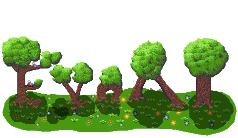

  [](https://cristianglezm.github.io/EvoAI/latest/index.html) [](https://opensource.org/licenses/Apache-2.0)

EvoAI is a C++17 library of building blocks to evolve, train and cluster **small** models, neural networks that are
evolved (NEAT, HyperNEAT) and / or trained (backpropagation), self-organizing maps, and the algorithms around them.

### Features

- A Genome to use NEAT and HyperNEAT algorithms to evolve Neural Networks.
- A Population(with speciation) to evolve your own "Genomes", it only needs to fulfill EvoAI::meta::is_populable_v<myClass>.
- Common Selection Algorithms.
- Train neural networks using backpropagation, enabling them to learn from labeled datasets, with the SGD, Adam and Muon
  optimizers, learning rate schedulers and loss functions.
- A SelfOrganizingMap (Kohonen) to cluster feature vectors with any distance metric, best matching units with their distance,
  evaluation (quantization and topographic error, how many samples each node won), a U-matrix, training that can be resumed
  and stopped, and JSON saving and loading.
- Evaluators to measure a network (neurons, connections, parameters, memory, sparsity, latency) and to combine the measures into an objective.
- A generic Graph and LatticeGraph with pathfinding algorithms and maze generation.

## News

<details>
<summary><strong>v1.5.0</strong> - SelfOrganizingMap API: best matching units with distance, evaluation, U-matrix, resumable training, shorter JSON (click to expand)</summary>

**Additions**
* `SelfOrganizingMap::classify()` returns a `BestMatchingUnit` with the grid coordinate (`x`, `y`) and the `distance` to the winning node, which the search computed anyway. When nodes are equally close the first one in row-major order wins.
* `SelfOrganizingMap::evaluate()` measures a map in one pass and returns a `SOMEvaluation`: mean quantization error, samples won by each node, used and skipped samples, `usedNodes()`, `busiestNodeCount()`, `fractionUsed()`, and optionally the topographic error (`Neighbourhood::Four` or `Eight`).
* `SelfOrganizingMap::uMatrix()`: the mean distance from every node to its neighbours, to see the borders between clusters.
* `train()` takes `TrainingOptions` and returns a `TrainingReport`. `epochOffset` continues the schedule in a later call (training 8 epochs equals 3 and then 5), `seed` makes the order of the samples depend only on the seed and the epoch, and `onEpoch` is called after every epoch with the learning rate, the radius and the mean distance of the samples to their winner, and can stop training. The report has one entry per epoch, the indices of the skipped samples and the wins per node of the last epoch.
* `SelfOrganizingMap::setWeightDecimals()` rounds the weights `toJson()` writes. For the 8x6x267 classifier of FlowerEvolver-WASM, 4 decimals write 24% of the JSON (63 KB of 263 KB) and classify the same samples into the same nodes. It is off by default, absolute (4 decimals would turn weights of the order of 0.00001 into 0), and not saved in the JSON. It needs a JsonBox that writes a double with the shortest text that reads back exactly, otherwise the JSON does not get shorter.
* `classify()`, `evaluate()`, `uMatrix()`, `getPrototype()` and `toJson()` only read the map and can be called from several threads at once while nobody is training it. `classify()` used a buffer shared by every caller, so concurrent calls could return a wrong node (3 in 51200 with four threads).
* Training is faster: a weight that decays towards 0 (a pixel that is 0 in every sample) used to become a denormal, and every update of a denormal is slow. Weights below 1e-100 are now set to 0: with 40% of the dimensions like that, 300 epochs on a 16x16 map took 52 s and now take 8 s. Nodes whose influence is below 1e-12 are not updated, which saves 3 to 10% more.

**Breaking changes**
* `classify()` returns `std::optional<BestMatchingUnit>` instead of an optional pair: `->first` and `->second` are `->x` and `->y`.
* `train()` returns a `TrainingReport` instead of the number of skipped samples (`report.skipped.size()`), and does not print to `std::cerr` any more.
* A `DistanceFn` is `double operator()(const double* a, const double* b, std::size_t n) const noexcept`, comparing the `n` values at `a` and `b`, instead of taking two `std::vector<double>`, and must not keep state. `EvoAI::meta::distance_metric_v` checks it.
* The weights after training differ from before by about 1e-13 (nodes with an influence below 1e-12 are not updated) and weights below 1e-100 are 0.

</details>

<details>
<summary><strong>v1.4</strong> - SelfOrganizingMap and LinearLR (click to expand)</summary>

* `SelfOrganizingMap`, a Kohonen map with a configurable distance metric, toroidal grids and JSON saving and loading.
* `LinearLR` scheduler.
* The state of optimizers and schedulers is validated against the live parameters when loaded, with fuzz harnesses for them.
* Later fixes: `StepLR` and `LinearLR` no longer divide by zero, EvoAI can be used as a CMake `FetchContent` dependency, and a saved map is validated before anything is sized from it.

</details>

<details>
<summary><strong>v1.3</strong> - evaluators, hardened JSON loading, MSVC (click to expand)</summary>

* Evaluators: composable network metrics (neurons, connections, parameters, memory, sparsity, latency) and weighted objectives.
* JSON deserialization is hardened against malformed input, with libFuzzer harnesses and a fuzz workflow.
* `mutateAddConnection` rejects self-loops and duplicate connections.
* A Windows MSVC build in CI, a modernized CMake build with static linking, fixed `FindJsonBox` and `FindEvoAI` modules (Debug and Release library names), and versioned docs.

</details>

<details>
<summary><strong>v1.2</strong> - Graph, LatticeGraph, pathfinding and mazes (click to expand)</summary>

* `Graph` and `LatticeGraph`: generic graphs with the pathfinding algorithms `DFS`, `BFS`, `GBFS` and `AStar`, and maze generation with `GrowingTree`. The new [Maze](examples/Maze) example races the four algorithms.
* Fixed undefined behaviour: out-of-bounds indexing, invalid layer access and tests with wrong expectations.
* The install paths no longer have trailing dots (CMake policy CMP0177).
* The CI is one cross-platform pipeline on the latest runner images, Dependabot keeps the actions and the docs requirements up to date, and the docs workflow was improved.

</details>

<details>
<summary><strong>v1.1</strong> - Muon optimizer and the docs site (click to expand)</summary>

* `Muon` optimizer.
* The documentation is built and published by a workflow, with versioned docs, and the README links to it.
* A CI workflow.
* `getExcessGenes` and `getDisjointGenes` take an optional hint so they do not copy.
* Fixed the compilation in Termux.

</details>

<details>
<summary><strong>v1.0</strong> - first release (click to expand)</summary>

* `Genome` with NEAT and HyperNEAT, and a `Population` with speciation for your own genomes.
* The selection algorithms.
* Neural networks trained with backpropagation: the `SGD` and `Adam` optimizers, the schedulers `ConstantLR`, `ExponentialLR`, `MultiplicativeLR`, `StepLR` and `MultiStepLR`, the losses `MeanError`, `MeanAbsoluteError`, `MeanSquaredError`, `BinaryCrossEntropy` and `MultiClassCrossEntropy`, and `DataLoader` and `DataSet`.
* The examples XOR, NumClassifier, IrisClassification and CellSim, and the tools GenomeVisualizer, ImageEvolver, ImageGenerator, ImageMixer, NeuralNetworkVisualizer and SoundGenerator.

</details>

## Code Examples

### Evolution

* Evolve an EvoString to the objective word.

```cpp
    std::string word("hello world!");
    constexpr auto numPop = 500u;
    EvoAI::Population<EvoAI::EvoString> pop(numPop,2.0,2.0,1.0, word.size());
    auto correct = 0u;
    auto eval = [&word, &correct](auto& w){
        correct = 0u;
        w.mutate();
        for(auto i=0u;i<word.size();++i){
            if(word[i] == w[i]){
                correct += 1;
            }
        }
        w.setFitness(correct);
    };
    do{
        pop.eval(eval);
        if(correct != word.size()){
            pop.reproduce(EvoAI::SelectionAlgorithms::Tournament<EvoAI::EvoString>{numPop}, true);
            pop.increaseAgeAndRemoveOldSpecies();
            pop.regrowPopulation(2.0, 2.0, 1.0, word.size());
        }
    }while(correct != word.size());
    auto best = pop.getBestMember();
    if(best){
        std::cout << "The best is ";
        for(auto i=0u;i<best->size();++i){
            std::cout << (*best)[i];
        }
        std::cout << '\0' << std::endl;
    }
```

### Learning

* Train a simple [IrisClassification](examples/IrisClassification/IrisClassification.cpp)

```cpp
    //...
    EvoAI::DataLoader<IrisDataset> trainingSet(IrisDataset(options.dataFilename, true, batchSize));
    EvoAI::DataLoader<IrisDataset> testingSet(IrisDataset(options.dataFilename, false, batchSize));
    //...
    EvoAI::Optimizer optim(0.1, batchSize, EvoAI::SGD(nn->getParameters(), 0.0), EvoAI::Scheduler(EvoAI::MultiStepLR({175}, 0.1)));
    EvoAI::writeMultiPlot("irisAvgLoss.txt", {"epochAvgLoss", "testAvgLoss", "accuracy"},
        nn->train(trainingSet, testingSet, optim, epoch, EvoAI::Loss::MultiClassCrossEntropy{}, testDataset));
    //...
```

### Clustering

* Train a self-organizing map on feature vectors, ask which node a sample falls on, measure the map and save it.

```cpp
    EvoAI::SelfOrganizingMap<> som(4u, 4u, 2u); // 4x4 nodes, 2 values per sample
    EvoAI::TrainingOptions options;
    options.seed = 42u; // with epochOffset, training in pieces gives the same weights as one call
    options.onEpoch = [](const EvoAI::EpochInfo& info){
        std::cout << "epoch " << info.epoch << " distance " << info.meanBmuDistance << '\n';
        return true; // false stops after this epoch
    };
    som.train(samples, 50u, 0.5, 2.0,
              EvoAI::Scheduler(EvoAI::ExponentialLR(0.95)), EvoAI::Scheduler(EvoAI::ExponentialLR(0.95)), options);
    auto bmu = som.classify({0.21, 0.19}); // x, y and distance of the winning node
    auto result = som.evaluate(samples, true); // mean error, wins per node, topographic error
    auto borders = som.uMatrix(); // distance of every node to its neighbours
    som.setWeightDecimals(4); // shorter JSON, see the news of v1.5.0
    som.toJson().writeToStream(file);
```

## Building ##

Requires CMake 3.7 and one of the following compilers:

* GCC 11.3 or newer; (C++17 support)
* Clang 7.1 or newer (Xcode 5.0 or newer on OS X);
* Visual Studio 2022 or newer;

EvoAI requires the following dependencies:

* [JsonBox](https://github.com/cristianglezm/JsonBox) 0.6.3 or newer

* [SFML](https://github.com/SFML/SFML) 2.6.x (tools and examples)

* [googletest](https://github.com/google/googletest) 1.7 or newer (tests)

Use CMake to build the project, if using vscode disable presets (as of now is not compatible with v7)

```bash
export SFML_ROOT=/full/path/to/sfml
export JsonBox_ROOT=/full/path/to/JsonBox
export GTest_ROOT=/full/path/to/googletest
mkdir build && cd build
cmake -G"MinGW Makefiles" -DSFML_ROOT=$SFML_ROOT -DJsonBox_ROOT=$JsonBox_ROOT -DGTest_ROOT=$GTest_ROOT \ 
-DEvoAI_BUILD_TESTS=TRUE -DEvoAI_BUILD_EXAMPLES=TRUE -DEvoAI_BUILD_DOCS=FALSE -DEvoAI_BUILD_TOOLS=TRUE ..
make -j4 install
```

### Android ###

You should set up ANDROID_NDK with the actual folder.
if you are compiling for termux you will need to compile with ``c++_static`` and 
add a ``-DEvoAI_BUILD_STATIC=TRUE``

```bash
mkdir build
cd build && mkdir armeabi-v7a
cd armeabi-v7a
export ANDROID_NDK=/full/path/to/android_ndk
cmake -DCMAKE_SYSTEM_NAME=Android -DCMAKE_ANDROID_NDK=$ANDROID_NDK \
        -DCMAKE_ANDROID_ARCH_ABI=armeabi-v7a -DCMAKE_ANDROID_STL_TYPE=c++_shared \
        -DCMAKE_ANDROID_API=26 -DCMAKE_BUILD_TYPE=Release \
        -DCMAKE_ANDROID_NDK_TOOLCHAIN_VERSION=clang \
        -DJsonBox_ROOT=$ANDROID_NDK/sources/third_party/JsonBox \
        -DCMAKE_INSTALL_PREFIX=$ANDROID_NDK/sources/third_party/EvoAI ../..
make -j4 install
```
### Emscripten ###

You can also build the library for emscripten to use it in the browser.

```bash
git clone https://github.com/emscripten-core/emsdk.git
cd emsdk
./emsdk install latest
./emsdk activate latest
source ./emsdk_env.sh
cd ..
git clone https://github.com/cristianglezm/JsonBox.git
cd JsonBox && mkdir build-em && cd build-em
emcmake cmake -G"MinGW Makefiles" ..
make -j4 install
cd ../..
export JsonBox_ROOT=/path/to/jsonbox
export GTest_ROOT=/path/to/googletest
emcmake cmake -G"MinGW Makefiles" -DJSonBox_ROOT=$JsonBox_ROOT -DGTest_ROOT=$GTest_ROOT -DEvoAI_BUILD_TESTS=TRUE ..
make -j4
```

Copy the following html code into build/test.html and run ``emrun test.html`` from the build dir after building it
then check the console log using webdev tools or use node to run it ``node bin/RunAllTests.js``

```html
<!DOCTYPE html>
<html lang="en">
<head>
    <meta charset="utf-8">
    <title>WASM EvoAI-RunAllTests Example</title>
    <meta name="viewport" content="width=device-width, initial-scale=1.0">
</head>
<body>
    <div>
      <h1>WASM EvoAI-RunAllTests Example</h1>
    </div>
    <script type='text/javascript'>
        var Module = {};
        fetch('bin/RunAllTests.wasm')
            .then(response => response.arrayBuffer())
            .then(buffer => {
                Module.wasmBinary = buffer;
                var script = document.createElement('script');
                script.src = 'bin/RunAllTests.js';
                script.onload = function() {
                  console.log('Emscripten boilerplate loaded.');
                }
                document.body.appendChild(script);
            });
    </script>
</body>
</html>
```

## Tools ##

* [GenomeVisualizer](tools/GenomeVisualizer): It lets you visualize genomes.
* [ImageEvolver](tools/ImageEvolver): Makes a batch of images and make them reproduce and evolve.
* [ImageGenerator](tools/ImageGenerator): Makes an image from the parameters.
* [ImageMixer](tools/ImageMixer): mix a number of images together(it takes the resolution from the first image).
* [NeuralNetworkVisualizer](tools/NeuralNetworkVisualizer): It lets you visualize Neural networks and produce a dot file.
* [SoundGenerator](tools/SoundGenerator): Makes a sound / midi file from the parameters.

## Examples ##

* [XOR](examples/XOR): Trains or evolves a Neural Network to Solve XOR
* [NumClassifier](examples/NumClassifier): trains a neural network to classify numbers.
* [IrisClassification](examples/IrisClassification): Trains or evolves a neural network to classify iris dataset
* [CellSim](examples/CellSim): Evolve different types of cells and see who takes over.
* [Maze](examples/Maze): Letters travel through a randomly generated maze (`LatticeGraph`, `GrowingTree`) to spell out a text, each one with a random search algorithm (`DFS`, `BFS`, `GBFS` or `AStar`), on a thread pool.

## Tests ##

* Make tests to check everything is working.

```bash
make RunAllTests && bin/RunAllTests
```

* If you don't want to run all tests use --gtest_filter "test.example", use --gtest_list_tests to check all the available tests.

## Contributions ##

Contributions are welcome, go to TODO.md and check out things to add or improve.

## Documentation ##

[latest version](https://cristianglezm.github.io/EvoAI/latest/index.html)

## License

Copyright 2015-2026 Cristian Gonzalez <cristian.glez.m@gmail.com>

Licensed under the Apache License, Version 2.0 (the "License"); you may not use this file except in compliance with the License. You may obtain a copy of the License at

   http://www.apache.org/licenses/LICENSE-2.0

Unless required by applicable law or agreed to in writing, software distributed under the License is distributed on an "AS IS" BASIS, WITHOUT WARRANTIES OR CONDITIONS OF ANY KIND, either express or implied. See the License for the specific language governing permissions and limitations under the License.
